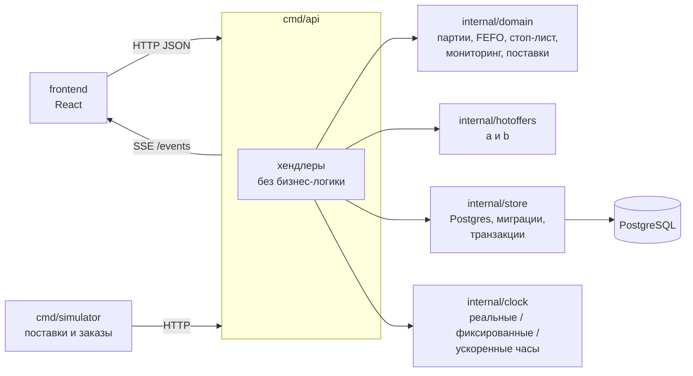

# umirhack-2026

Сервис учёта склада ресторана: поставки партиями, остатки и сроки годности по каждой партии, проверка и списание ингредиентов при заказе, автоматический стоп-лист, предупреждения об истекающих партиях, предложение поставок и «горячие предложения» — блюда, которые стоит продвигать, чтобы не списывать продукты.

Подробные правила и решения: `.ai/main-prompt.md`, `.ai/solution.md`. Если они расходятся, прав `.ai/solution.md`.

## Архитектура

Стек: Go (HTTP JSON API + SSE), PostgreSQL, React. Один экземпляр API, развёртывание через `docker compose`.

Опорная идея: **склад — это партии и журнал движений**. Партия доступна, пока `remaining > 0` и `now < expires_at`. Остатки, стоп-лист, статус «истекает», предложение поставок и горячие предложения — чистые функции от снимка (партии, рецепты, история спроса, время). Они считаются при чтении и не хранятся как состояние, поэтому не могут разойтись со складом.

### Структура репозитория

| Путь | Назначение |
|---|---|
| `internal/domain` | Чистая логика: партии, FEFO, проверка и списание, стоп-лист, мониторинг сроков, предложение поставок. Не знает о БД, сети и текущем времени (`time.Now()` не вызывается, время приходит аргументом). |
| `internal/hotoffers/a`, `internal/hotoffers/b` | Две версии алгоритма горячих предложений за одним интерфейсом, чистые функции. `a` — «требуемый темп», `b` — жадное распределение с предохранителем. Основной выбирается `HOTOFFERS_ALGO`. |
| `internal/store` | Postgres, миграции, транзакции. |
| `internal/clock` | Интерфейс часов: реальные, фиксированные (тесты), ускоренные (симулятор и демо). |
| `cmd/api` | HTTP JSON API и SSE-поток событий `GET /events`. |
| `cmd/simulator` | Генератор поставок и заказов с seed и множителем скорости времени; режим `bench` для сравнения алгоритмов. |
| `frontend/` | React. Бизнес-логику не считает: стоп-лист, сроки и рекомендации приходят с бэкенда. |
| `tests/invariants/` | Тесты-сторожа инвариантов. Меняют только люди. |
| `e2e/` | Playwright, демо-сценарий. |
| `deploy/` | `docker-compose.yml`. |
| `scripts/` | Вспомогательные скрипты, в том числе `smoke.sh`. |
| `.ai/` | Правила проекта и решения для агентов-исполнителей. |

### Ключевые решения

- **Партии и FEFO.** Одна позиция поставки — одна партия. Списание строго по ближайшему сроку годности `(expires_at, batch_id)`. Приём поставки идемпотентен по её `id`.
- **Заказ атомарен и идемпотентен.** Потребность суммируется по всем блюдам заказа; заказ списывает всё или ничего. Отказ хранится со статусом `rejected` и перечнем нехватки. Повтор с тем же `id` не списывает дважды.
- **Конкурентность.** Все писатели партий (заказ, поставка, фоновый «дворник», прыжок времени) первой операцией блокируют затронутые продукты `SELECT … FOR UPDATE`, поэтому параллельные заказы не продают одну порцию дважды.
- **Время.** Моменты хранятся как `timestamptz` (UTC), на проводе — RFC 3339; зона ресторана задаётся `RESTAURANT_TZ`. Просрочка исключается предикатом времени в каждом запросе, а не событием, поэтому стоп-лист верен, даже если фоновый проход не успел. Каждый ответ API несёт заголовок `X-Stand-Time`.
- **Количества.** Целые `int64` в базовых единицах (`g`, `ml`, `pcs`), без float; разбор единиц и проверенная арифметика — в одном месте.
- **Стоп-лист.** Блюдо в стоп-листе, если хотя бы одного ингредиента не хватает на одну порцию из непросроченных остатков; считается при чтении, с причиной.
- **События SSE.** Это сигналы «перечитай» (`stock.changed`, `stoplist.changed`, `batch.expiring`, `hotoffers.changed`, `clock.changed` и др.); фронт перезапрашивает данные по HTTP.

### Инварианты

Каждый закреплён тестом в `tests/invariants/`:

1. Сохранение количества: поступило − списано = сумма остатков; ни одна партия не уходит в минус.
2. Атомарность заказа.
3. Параллельные заказы не продают одну порцию дважды.
4. FEFO; просроченная партия не участвует ни в списании, ни в доступности.
5. Стоп-лист — функция остатков и времени: после любого события равен пересчёту с нуля.
6. Горячие предложения допустимы: нет блюд из стоп-листа, у каждой рекомендации есть объяснение со ссылкой на партию.

## Конфигурация

Через переменные окружения (полный список — `.ai/solution.md`, раздел 7.6): `DATABASE_URL`, `RESTAURANT_TZ`, `OPEN_AT`/`CLOSE_AT`, `HOTOFFERS_ALGO`, `CLOCK_MODE`, `DEMO_MODE`/`DEMO_TOKEN`, `DB_POOL_SIZE` и др. Секретов в коде нет.
